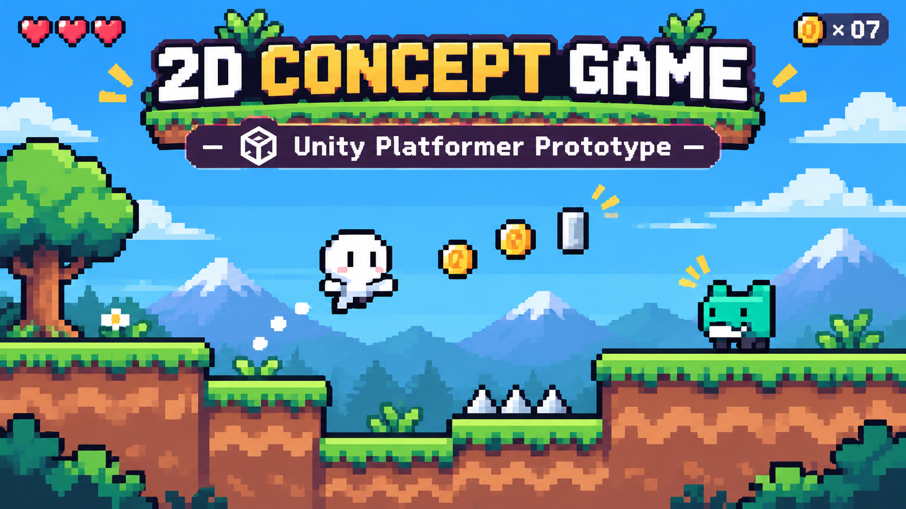

<p align="center">
  
</p>

<h1 align="center">2D Concept Game</h1>

<p align="center">
  A little 2D platformer experiment made in Unity.<br>
  <sub>Jumping around, testing ideas, and learning how games actually come together.</sub>
</p>

<p align="center">
  
  
  
</p>

---

## What's the game about?

It's a simple side-scrolling platformer concept: a small character, some platforms to get across, and an enemy that's not exactly there to help.

I started this project to get more hands-on with Unity instead of just reading about how things work. It's where I'm trying out movement, 2D physics, scene setup, and all the tiny details that make a platformer feel like a game.

It's **not a finished game** (yet). This repo is the working Unity project, bugs and experiments included.

## What's in it so far?

- **Player character** — sprite-based player set up with Unity's 2D physics components.
- **Platforms & collisions** — a small scene for experimenting with jumping and level layout.
- **Moving platform** — a platform setup with two reference points.
- **Enemy setup** — enemy-related objects and a spawn point in the scene.
- **2D camera** — an orthographic view to keep everything in frame.

The white character and teal enemy in the cover are based on the game's character references. The banner is **illustration art**, not a gameplay screenshot.

## Want to open it?

You'll need [Unity Hub](https://unity.com/download) and **Unity 2021.3.10f1**. That's the version the project was created with.

1. Clone the repo:
   ```bash
   git clone https://github.com/y0u553fcsx/2D-Concept-Game.git
   ```
2. In **Unity Hub**, choose **Add project from disk** and select the cloned folder.
3. Open it with **Unity 2021.3.10f1** and let Unity import everything.
4. Open `Assets/Scenes/SampleScene.unity` in the Unity Editor.
5. Hit **Play** to explore the current prototype.

> There's no downloadable build here right now — you'll need the Unity Editor to run it.

## The project folders

```text
2D-Concept-Game/
├── Assets/            Game assets, scenes and scripts
├── Packages/          Unity packages
└── ProjectSettings/   Unity project configuration
```

## Things I want to try next

- [ ] Make the character movement feel better
- [ ] Add more interesting platform layouts
- [ ] Work more on enemy behavior and interactions
- [ ] Add sound effects and small bits of game feel
- [ ] Record a short gameplay GIF for this README

No big roadmap or promises. Just a small project I'll keep improving as I learn.

---

<p align="center">
  <sub>Made by <a href="https://github.com/y0u553fcsx">Youssef</a> · Built to learn, not to be perfect.</sub>
</p>
