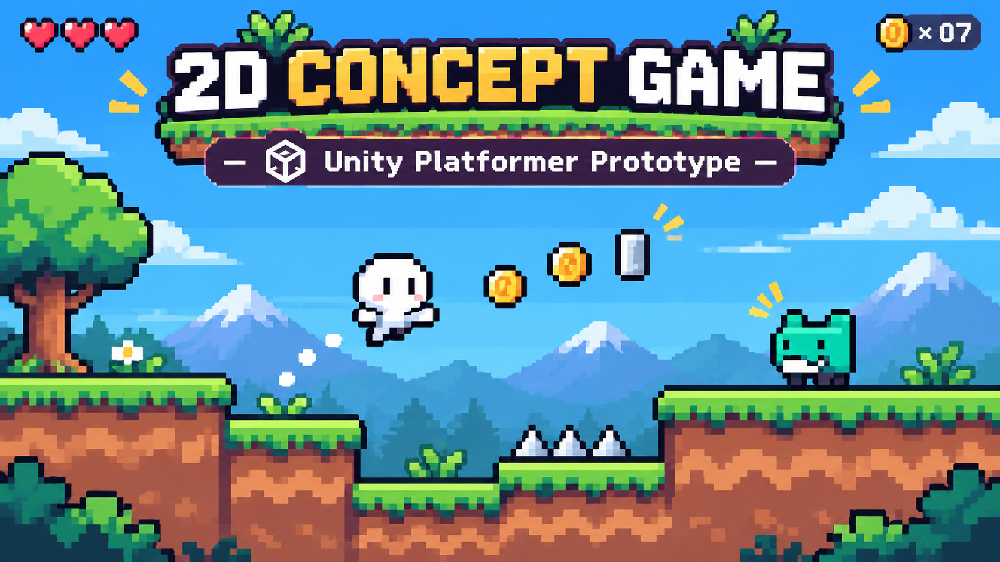
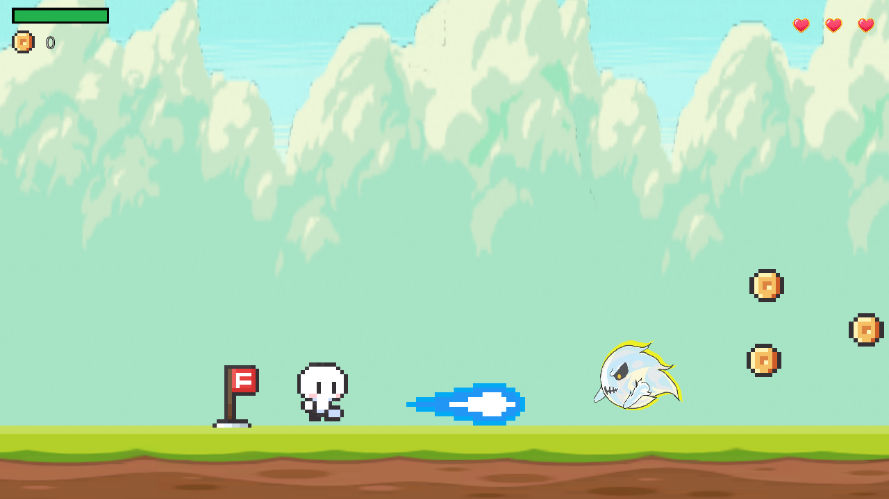
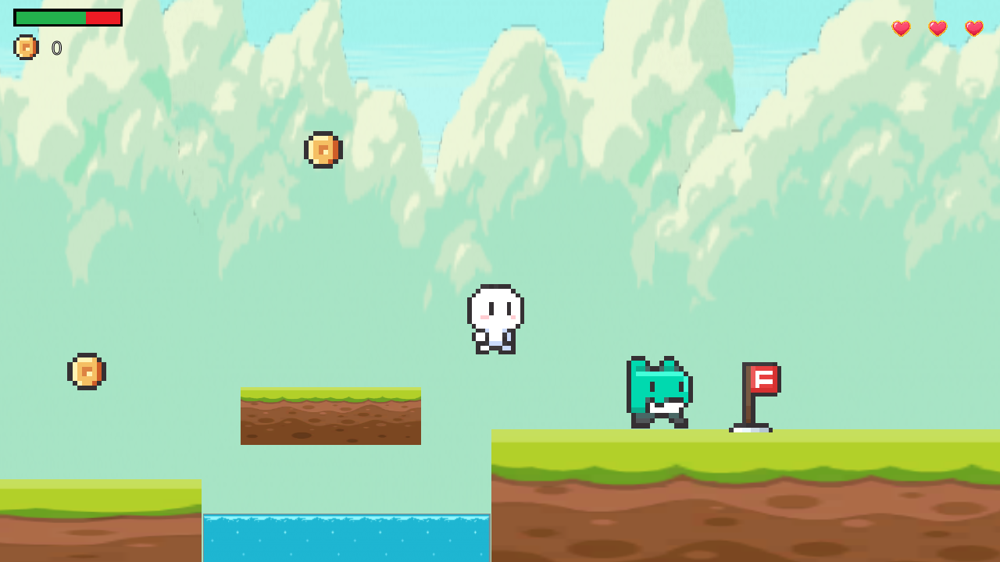
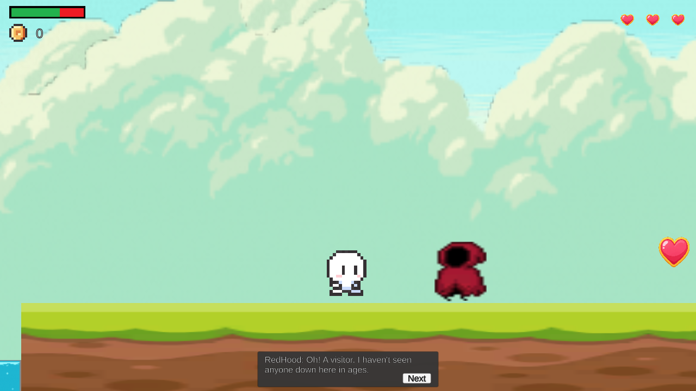
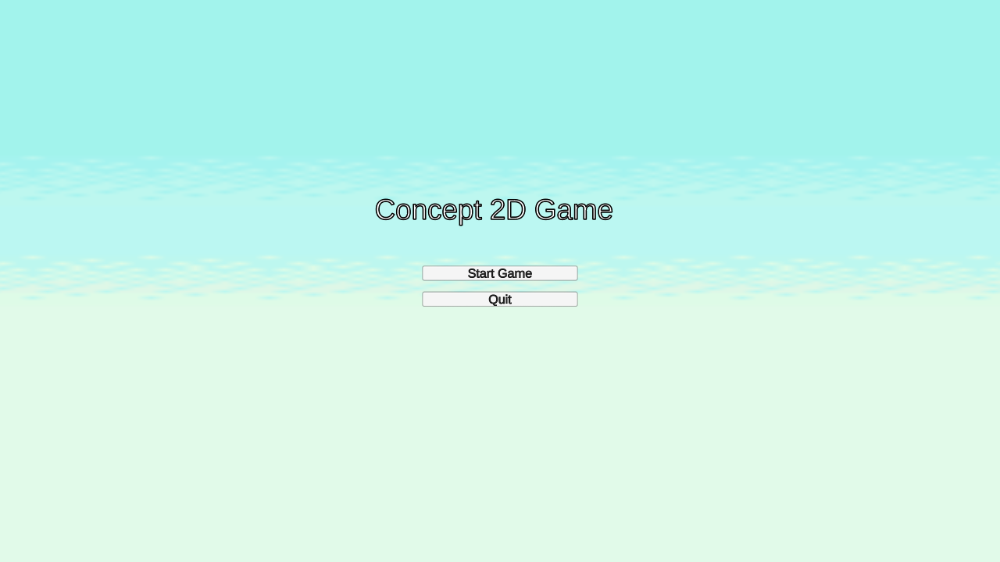

<p align="center">
  
</p>

<h1 align="center">2D Concept Game</h1>

<p align="center">
  A little 2D platformer experiment made in Unity.<br>
  <sub>Jumping around, testing ideas, and learning how games actually come together.</sub>
</p>

<p align="center">
  
  
  
</p>

---

## What's the game about?

You play as Bobby in a side-scrolling platformer. RedHood has a tip for finding your way out. Head east, ride a rising platform, break bricks with your head, and fire blue bullets at the enemies between you and the next red flag.

I started this project to get more hands-on with Unity instead of just reading about how things work. It's where I'm trying out movement, 2D physics, scene setup, and all the tiny details that make a platformer feel like a game.

## Play on Windows

1. [Download the Windows x64 build (ZIP)](https://github.com/y0u553fcsx/2D-Concept-Game/releases/latest/download/2D-Concept-Game-Windows-x64.zip).
2. Right-click the ZIP and choose **Extract All**. Keep the executable, data folder, and runtime files together.
3. Open **`2D-Concept-Game.exe`** and click **Start Game**.

| Action | Control |
| --- | --- |
| Move left or right | Left or Right arrow |
| Jump | Space |
| Shoot in the direction Bobby is facing | Tab |
| Zoom the camera | Mouse wheel |
| Talk to RedHood | Walk up to RedHood, then click **Next** after each line appears |

## Screenshots

<table>
  <tr>
    <td width="50%"><a href="docs/screenshots/checkpoint-shot.png"></a><br>Firing from the checkpoint</td>
    <td width="50%"><a href="docs/screenshots/platform-patrol.png"></a><br>Jumping past the lakeside patrol</td>
  </tr>
  <tr>
    <td><a href="docs/screenshots/redhood-dialogue.png"></a><br>Meeting RedHood</td>
    <td><a href="docs/screenshots/title-screen.png"></a><br>Title screen</td>
  </tr>
</table>

## What's in it so far?

- **Dialogue.** RedHood and Bobby's conversation appears a letter at a time. Bobby stands still until you finish the exchange.
- **Combat.** Some enemies patrol between two points and others chase Bobby. Crossing the ghost spawn point brings out a ghost. Blue bullets damage enemies and disappear when they hit a wall.
- **Platforming.** Ride the moving platform, hit bricks from below, and cross a trapdoor that swings down under your feet and closes again after a delay.
- **Checkpoints and pickups.** Red flags set your respawn point. Coins add to your score, and heart pickups restore one health point when you're hurt.
- **Health and lives.** The HUD shows your score, health bar, and remaining lives. Bobby briefly flickers after taking damage. When you run out of health and lives, the Game Over screen offers **Retry** and **Quit**.
- **Camera and sound.** The camera follows Bobby and lets you zoom with the mouse wheel. Overworld music plays during the level. Each coin plays one of two pickup sounds, and hearts have their own sound.

The cover is an illustration of the game's white player character and teal enemy.

## Open the project in Unity

You'll need [Unity Hub](https://unity.com/download) and **Unity 2021.3.10f1**. That's the version the project was created with.

1. Clone the repo.
   ```bash
   git clone https://github.com/y0u553fcsx/2D-Concept-Game.git
   ```
2. In **Unity Hub**, choose **Add project from disk** and select the cloned folder.
3. Open it with **Unity 2021.3.10f1** and let Unity import everything.
4. Open `Assets/Scenes/IntroScreen.unity`, hit **Play**, then click **Start Game**. To work on the playable level directly, open `Assets/Scenes/Level1.unity`.

## The project folders

```text
2D-Concept-Game/
├── Assets/Scenes/     IntroScreen, Level1 and GameOver
├── Assets/Scripts/    Player, enemies, dialogue, pickups, menus and audio
├── Assets/Prefabs/    Reusable enemies, bullets, pickups and checkpoints
├── Packages/          Unity packages
└── ProjectSettings/   Unity project configuration
```

## Things I want to try next

- [ ] Make the character movement feel better
- [ ] Add more interesting platform layouts
- [ ] Work more on enemy behavior and interactions
- [ ] Record a short gameplay GIF for this README

No big roadmap or promises. Just a small project I'll keep improving as I learn.

---

<p align="center">
  <sub>Made by <a href="https://github.com/y0u553fcsx">Youssef</a> · Built to learn, not to be perfect.</sub>
</p>
